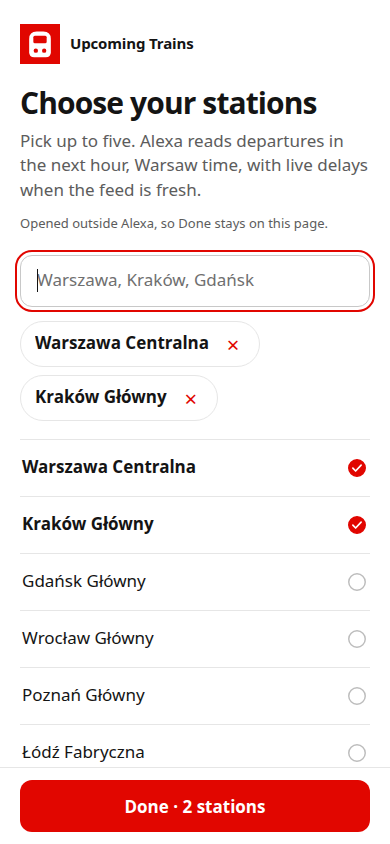

# My Train Schedule

An Alexa skill for your next trains, now or at a time you choose. It currently supports Poland.

## Try it

- "Alexa, open my train schedule."
- "Alexa, ask my train schedule for arrivals."
- "Alexa, ask my train schedule for departures at 8 am."
- "Alexa, ask my train schedule for departures tomorrow at 8 am."
- "Alexa, ask my train schedule to change my stations."

Alexa reads the trains in the next 60 minutes at your stations, or in the hour from a time you name, grouped by direction and line. Live delays are included for the coming hour when they're available. The skill speaks English (US and UK).

## How it works

1. Enable the skill in the Alexa app and tap **Link Account**.
2. This page opens. Search for up to five stations.
3. Choose which directions to hear at each station. Long-distance trains are one option.
4. Optionally paste your own [ElevenLabs](https://elevenlabs.io) API key for a natural voice. Leave it empty for the standard Alexa voice. Tap **Done**.
5. The page puts your stations, directions and optional key into the access token and returns you to Alexa.
6. When you ask, the skill reads the token and looks up the timetable and live delays.

## What this repository is

The full skill lives in this repository: the Lambda code, the interaction model, the station picker, and the timetable build. See [ARCHITECTURE.md](ARCHITECTURE.md) for the technical details.

The station picker and the privacy policy are static pages served by GitHub Pages:

- Station picker: https://a-rebets.github.io/alexa-skill-poland-trains/
- Privacy policy: https://a-rebets.github.io/alexa-skill-poland-trains/privacy.html

## Timetable data

The station list (`stations.js`, `stations.json`) and the per-station directions (`directions.json`) aren't committed. They are build output. The [Refresh timetable](.github/workflows/refresh-timetable.yml) workflow builds them every Monday at about 07:00 Warsaw time, on every push to `main`, and on demand:

1. Downloads the [Polish Trains GTFS](https://mkuran.pl/gtfs/) feed, which is regenerated daily from PKP PLK data, so diversions and closures show up once PLK publishes them.
2. Runs `scripts/build_data.py`, which writes the picker files and the skill's compact timetable (`schedule.bin`). `lambda/upcoming_trains/` holds the few skill modules the build needs.
3. Publishes the picker with GitHub Pages. The cache-busting version gets a digest of that week's data appended.
4. Pushes `schedule.bin` to the Alexa-hosted skill when the timetable changed, waits for the deploy, and asks the skill for departures as a smoke test.
5. Fails, so GitHub sends an email, if any step breaks or the feed's calendar ends within 10 days.

To build locally: `python3 scripts/build_data.py --out build/lambda/data/schedule.bin --picker-dir .` (Python 3.10+, standard library only).

## Privacy

You don't create an account, and nothing is stored on a server. What you pick (stations, directions and, if you add one, your ElevenLabs key) lives only inside the account-linking token. The skill sends the key only to ElevenLabs and never writes it to a file or log.

## Attribution

Timetable and live delay data comes from the [Polish Trains GTFS](https://mkuran.pl/gtfs/) feed processed by Mikołaj Kuranowski. The schedules are provided by PKP Polskie Linie Kolejowe S.A. and used under the PKP PLK public sector data usage terms. The live delay feed is also available under [CC BY 4.0](https://creativecommons.org/licenses/by/4.0/).

Amazon, Alexa, and all related marks are trademarks of Amazon.com, Inc. or its affiliates.
